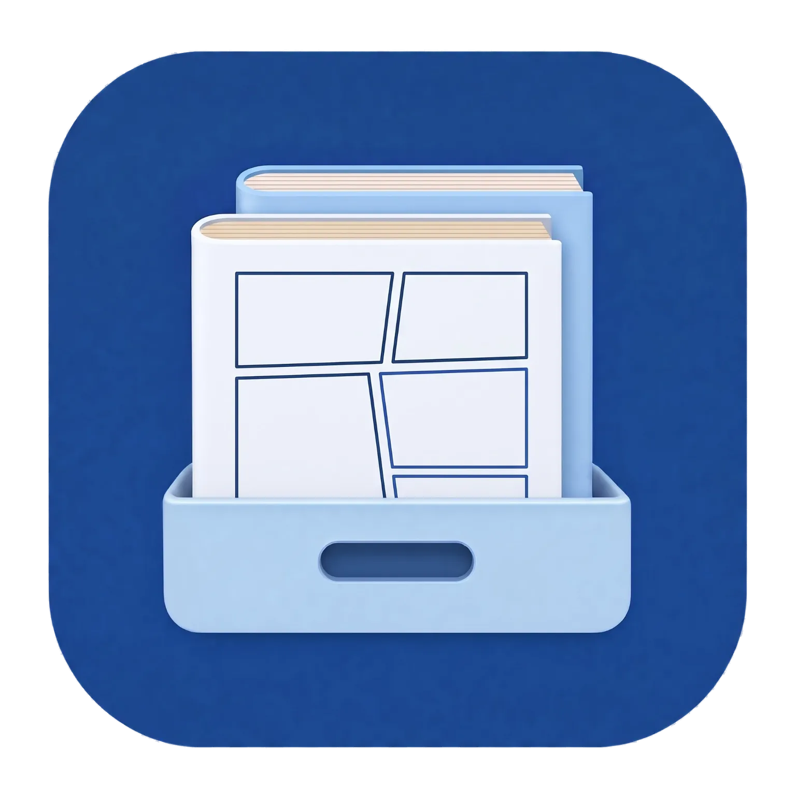

<p align="center">
  
</p>

<h1 align="center">comic-dl</h1>

<p align="center">
  <strong>好きな漫画を、自分だけの本棚に。</strong><br />
  拡張可能な漫画ダウンロード CLI と TypeScript ライブラリ<br />
  複数のソース · 自動更新 · CBZ / ZIP アーカイブ
</p>

<p align="center">
  <a href="https://www.npmjs.com/package/comic-dl"></a>
  <a href="https://nodejs.org/"></a>
  <a href="https://github.com/yinyanfr/comic-dl/actions/workflows/ci.yml"></a>
  <a href="https://github.com/yinyanfr/comic-dl/actions/workflows/publish-npm.yml"></a>
  <a href="LICENSE"></a>
</p>

<p align="center">
  <a href="#クイックスタート">クイックスタート</a> ·
  <a href="https://yinyanfr.github.io/comic-dl/ja/">ドキュメント</a> ·
  <a href="https://github.com/yinyanfr/comic-dl-extensions">ソース拡張機能</a> ·
  <a href="https://github.com/yinyanfr/comic-dl-web">Web UI</a> ·
  <a href="CHANGELOG.md">変更履歴</a> ·
  <a href="README.md">简体中文</a> ·
  <a href="README.en.md">English</a>
</p>

## クイックスタート

コアとソース拡張機能をインストールすると、各チャプターを個別の CBZ として保存できます。

```sh
comic-dl d "https://www.copy20.com/comic/xiangkanbaitiantongxuederuanruobiaoqing"
```

以下の CopyManga 拡張機能をインストールした後、作品の URL を渡すとソースを自動判定し、作品全体を現在のディレクトリにダウンロードします。`d` は `download` の省略形です。

```sh
comic-dl d xiangkanbaitiantongxuederuanruobiaoqing --source copymanga -o ~/manga -c 2-4
```

作品の短い ID も使えます。`-o` は保存先、`-c 2-4` は一覧の 2 番目から 4 番目まで（両端を含む）を指定します。範囲が一覧を超える場合、ダウンロードを開始せずエラーになります。

既定の保存先は出力ディレクトリ内の `作品名/番号-チャプター名.cbz` です。命名テンプレート、ゼロ埋め、ZIP に対応しています。旧形式のハッシュ名 CBZ も識別情報で認識され、自動では改名されません。[4.x 移行ガイド](https://yinyanfr.github.io/comic-dl/ja/migration/v3-to-v4/)を参照してください。

## インストール

### 4.1.0 の新機能

CLI にページ進捗、`extensions`、`update --check`、`search --json`、`list --details`、アーカイブ設定、手動 NAS 保護、移行のプレビュー・適用を追加しました。既定の進捗は端末の stderr のみで、ログには `--progress plain` を使います。[CLI リファレンス](https://yinyanfr.github.io/comic-dl/ja/reference/cli/)と[変更履歴](CHANGELOG.md#410--2026-11-28)を参照してください。4.0 からの更新で本棚スキーマの再移行は不要で、既存アーカイブは自動改名されません。

Node.js 24 を使用してください。コアにオンラインソースは含まれません。CLI の `add` で拡張機能を追加します。

```sh
npm install -g comic-dl@latest
comic-dl add @comic-dl/copymanga
comic-dl sources
```

`comic-dl update @comic-dl/copymanga` は単一の拡張機能、`comic-dl update` はすべてを更新します。`comic-dl remove @comic-dl/copymanga` で削除できます。公式に保守する拡張機能は [comic-dl-extensions](https://github.com/yinyanfr/comic-dl-extensions) にあります。第三者も npm パッケージとして公開できます。

## ブラウザーで管理するには

[comic-dl-web](https://github.com/yinyanfr/comic-dl-web) は、本プロジェクトを利用した独立したセルフホスト型 Web UI です。NAS やローカルの漫画コレクション向けに、ソースの閲覧、手動ダウンロード、本棚、自動更新を提供します。コアはダウンロードとアーカイブを、拡張機能はソースを担当します。デプロイと設定は Web リポジトリを参照してください。

## 複数ソースの本棚と自動更新

3.1.0 以降、`comic-dl shelf add` で複数ソースの作品を同じローカル本棚に登録し、`shelf follow <項目 ID>` で購読できます。`shelf check` は手動で新着を確認してキューに登録し、`shelf watch --output ~/manga` は定期的に確認してキュー内のチャプターを CBZ として保存します。初回の正常な確認では既存チャプターの記録のみ行います。既存分もダウンロードするには `shelf check <項目 ID> --include-history` を使います。

詳しくは[本棚の管理](https://yinyanfr.github.io/comic-dl/ja/shelf/manage/)と[更新確認と自動ダウンロード](https://yinyanfr.github.io/comic-dl/ja/shelf/updates/)を参照してください。

## ライブラリとして使う

```sh
npm install comic-dl@latest @comic-dl/zerobyw
```

```typescript
import downloader from 'comic-dl';
import zerobyw from '@comic-dl/zerobyw';

downloader.use(zerobyw);

// 実際の作品 URL に置き換えてください。Zerobyw には有効なセッションが必要です。
const results = await downloader.download(
  'https://www.zerobyw33.com/pc/details/?kuid=123',
  { directory: './downloads' },
);
console.log(results);
```

セッションの設定は [Zerobyw 拡張機能の README](https://github.com/yinyanfr/comic-dl-extensions/blob/main/extensions/zerobyw/README.en.md) を参照してください。

独立した Node.js サービスや Web UI のバックエンドでは、ライブラリ API で検索、選択ダウンロード、本棚・購読の管理、自動更新、拡張機能の追加・更新・削除を実行できます。CLI の本棚や拡張ストアを共有することも、別のパスを指定することもできます。[ライブラリガイド](https://yinyanfr.github.io/comic-dl/ja/guide/library/)を参照してください。

バージョン 4 では独立した自動化スイッチ、安全なタスクスナップショットとページイベント、認証付き表紙、拡張機能一覧、更新確認専用 API も利用できます。[Web バックエンドとタスク API](https://yinyanfr.github.io/comic-dl/ja/guide/service-api/)を参照してください。

## ドキュメント

- [インストールとソースの追加](https://yinyanfr.github.io/comic-dl/ja/guide/quickstart/)、[基本的な使い方](https://yinyanfr.github.io/comic-dl/ja/guide/basic/)
- [高度な使い方](https://yinyanfr.github.io/comic-dl/ja/guide/advanced/)、[設定ファイル](https://yinyanfr.github.io/comic-dl/ja/guide/config-tutorial/)、[CLI リファレンス](https://yinyanfr.github.io/comic-dl/ja/reference/cli/)
- [ライブラリとして使う](https://yinyanfr.github.io/comic-dl/ja/guide/library/)：CLI と API の対応、本棚の更新、拡張機能の管理例
- [2.x から 3.x への移行](https://yinyanfr.github.io/comic-dl/ja/migration/v2-to-v3/)
- [開発への参加](https://yinyanfr.github.io/comic-dl/ja/development/contributing/)、[ローカルテスト](https://yinyanfr.github.io/comic-dl/ja/development/local-testing/)、[ソース拡張機能の開発](https://yinyanfr.github.io/comic-dl/ja/extensions/develop/)
