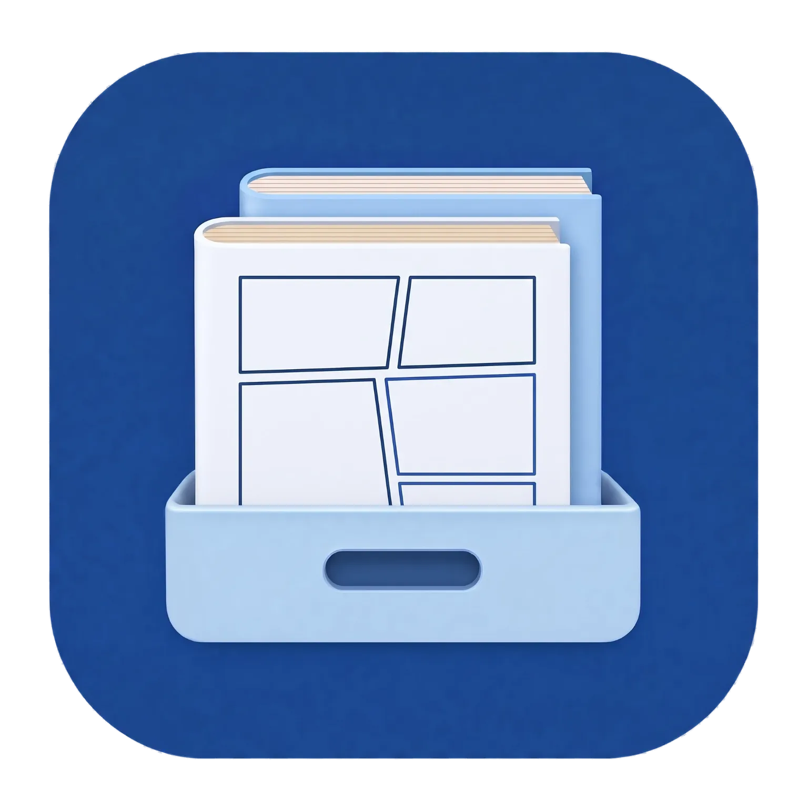

<p align="center">
  
</p>

<h1 align="center">comic-dl</h1>

<p align="center">
  <strong>把喜欢的漫画，整理成自己的书架。</strong><br />
  可扩展的漫画下载 CLI 与 TypeScript 库<br />
  多来源 · 自动追更 · CBZ / ZIP 归档
</p>

<p align="center">
  <a href="https://www.npmjs.com/package/comic-dl"></a>
  <a href="https://nodejs.org/"></a>
  <a href="https://github.com/yinyanfr/comic-dl/actions/workflows/ci.yml"></a>
  <a href="https://github.com/yinyanfr/comic-dl/actions/workflows/publish-npm.yml"></a>
  <a href="LICENSE"></a>
</p>

<p align="center">
  <a href="#快速开始">快速开始</a> ·
  <a href="https://yinyanfr.github.io/comic-dl/">文档</a> ·
  <a href="https://github.com/yinyanfr/comic-dl-extensions">漫画源扩展</a> ·
  <a href="https://github.com/yinyanfr/comic-dl-web">Web 界面</a> ·
  <a href="CHANGELOG.md">更新日志</a> ·
  <a href="README.en.md">English</a> ·
  <a href="README.ja.md">日本語</a>
</p>

## 快速开始

安装核心与漫画源扩展后，每章可保存为独立 CBZ：

```sh
comic-dl d "https://www.copy20.com/comic/xiangkanbaitiantongxuederuanruobiaoqing"
```

安装下文的 CopyManga 扩展后，贴上作品链接即可自动选源，把整部漫画下载到当前目录。`d` 是 `download` 的简写。

```sh
comic-dl d xiangkanbaitiantongxuederuanruobiaoqing --source copymanga -o ~/manga -c 2-4
```

也可以直接用作品短 ID。`-o` 指定下载目录，`-c 2-4` 按阅读顺序下载第 2 到第 4 个章节（含两端）。范围超出章节列表时，命令会报错，且不会开始下载。

默认在输出目录下保存为 `作品名/序号-章节名.cbz`，支持命名模板、补零和 ZIP。旧哈希 CBZ 仍按身份识别，不自动改名。详见 [4.x 迁移](https://yinyanfr.github.io/comic-dl/migration/v3-to-v4/)。

## 安装

### 4.1.0 更新

CLI 新增逐页进度、`extensions`、`update --check`、`search --json`、`list --details`、归档参数、手动 NAS 保护及归档迁移预览/应用。默认进度仅在终端的 stderr 显示，日志使用 `--progress plain`。详见 [CLI 手册](https://yinyanfr.github.io/comic-dl/reference/cli/)与[更新日志](CHANGELOG.md#410--2026-11-28)。4.0 用户无需再次迁移书架 schema；旧归档不会自动改名。

使用 Node.js 24。核心不附带在线漫画源，CLI 通过 `add` 安装扩展：

```sh
npm install -g comic-dl@latest
comic-dl add @comic-dl/copymanga
comic-dl sources
```

`comic-dl update @comic-dl/copymanga` 更新单个扩展，`comic-dl update` 更新全部，`comic-dl remove @comic-dl/copymanga` 卸载。我们维护的扩展位于 [comic-dl-extensions](https://github.com/yinyanfr/comic-dl-extensions)；第三方也可独立发布 npm 包。

## 想用浏览器管理？

[comic-dl-web](https://github.com/yinyanfr/comic-dl-web) 是基于本项目的独立自托管 Web 界面，面向 NAS 与本地漫画收藏，提供来源浏览、手动下载、书架与自动追更。核心负责下载与归档，漫画源由扩展提供；部署和配置请前往 Web 仓库。

## 跨来源书架与自动追更

从 3.1.0 起，可以用 `comic-dl shelf add` 把不同来源的作品收藏到同一个本地书架，再用 `shelf follow <条目 ID>` 订阅。`shelf check` 手动检查并登记新章，`shelf watch --output ~/manga` 定时检查并把队列中的章节保存为 CBZ。首次成功检查默认只记录已有章节；要补下载，可用 `shelf check <条目 ID> --include-history`。

详见[管理书架](https://yinyanfr.github.io/comic-dl/shelf/manage/)和[检查更新与自动下载](https://yinyanfr.github.io/comic-dl/shelf/updates/)。

## 在项目中使用

```sh
npm install comic-dl@latest @comic-dl/zerobyw
```

```typescript
import downloader from 'comic-dl';
import zerobyw from '@comic-dl/zerobyw';

downloader.use(zerobyw);

// 将链接换成要下载的作品；Zerobyw 需要有效的登录会话。
const results = await downloader.download(
  'https://www.zerobyw33.com/pc/details/?kuid=123',
  {
    directory: './downloads',
  },
);
console.log(results);
```

独立的 Node.js 服务或 Web UI 后端可以直接使用库 API 来搜索、选章下载、管理书架和订阅、运行自动追更，以及安装、更新或卸载扩展。书架和扩展仓库可以与 CLI 共用，也可以为服务指定独立路径。参见[库使用指南](https://yinyanfr.github.io/comic-dl/guide/library/)。

4.x 还提供独立自动检查/下载开关、安全任务快照和逐页事件、鉴权封面、扩展清单与只检查更新的 API，见 [Web 后端指南](https://yinyanfr.github.io/comic-dl/guide/service-api/)。

## 文档

- [安装本体与添加漫画源](https://yinyanfr.github.io/comic-dl/guide/quickstart/)与[简单的使用](https://yinyanfr.github.io/comic-dl/guide/basic/)：从安装到搜索、列章和下载
- [复杂的使用](https://yinyanfr.github.io/comic-dl/guide/advanced/)、[使用配置文件](https://yinyanfr.github.io/comic-dl/guide/config-tutorial/)与 [CLI 参考](https://yinyanfr.github.io/comic-dl/reference/cli/)
- [作为库使用](https://yinyanfr.github.io/comic-dl/guide/library/)：CLI 与库 API 对照、书架追更及扩展管理示例
- [从 2.x 升级到 3.x](https://yinyanfr.github.io/comic-dl/migration/v2-to-v3/)：迁移命令、预设和凭据，保留已下载的漫画
- [项目开发](https://yinyanfr.github.io/comic-dl/development/contributing/)、[本地开发测试](https://yinyanfr.github.io/comic-dl/development/local-testing/)与[漫画源扩展开发](https://yinyanfr.github.io/comic-dl/extensions/develop/)
